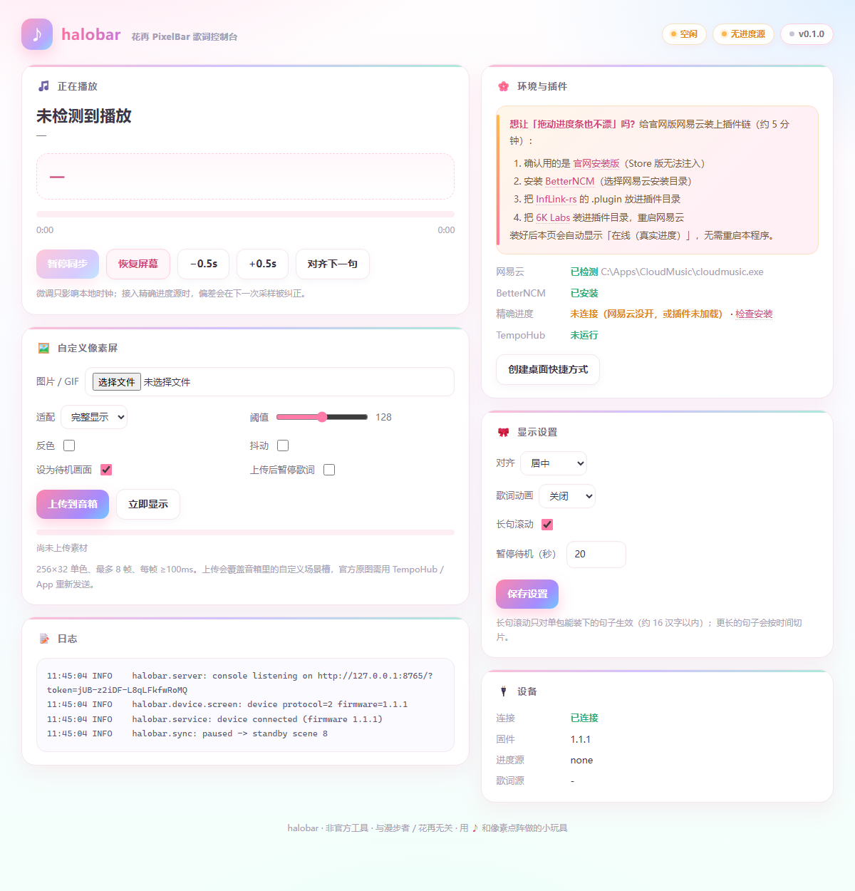

<div align="center">


<h1>halobar</h1>

把正在播放的歌词，送到桌面音箱的那条像素屏上。

[](https://github.com/zhuiye8/halo-tools/actions/workflows/ci.yml)
[](LICENSE)




</div>

---

## 这是什么

halobar 是给「漫步者 / 花再 Halo PixelBar」写的一个 Windows 小工具，主要做两件事：

- 把当前播放的歌词，实时显示在音箱那条 256×32 的像素屏上；
- 允许把任意图片或 GIF 传上去，当待机画面，或者只是摆着好看。

音箱本身只有九种内置场景、自创文字最多 16 个字，官方歌词功能又只对手机蓝牙开放。这个项目补的就是这两个缺口：桌面端也能看歌词，屏幕内容也不再被官方素材限制。

它不刷固件，只用设备公开的 HID 命令写显示内容。程序启动时会记下你原来的画面，退出时还原。

## 下载

> 首个版本还在打包，完成后会放在 [Releases](https://github.com/zhuiye8/halo-tools/releases)。在那之前请从源码运行，见文末「开发」。

发布包是免安装的 zip：解压到任意目录，双击 `halobar.exe` 就可以了。不需要装 Python，也不需要管理员权限。桌面上的快捷方式可以在控制台里一键创建。

第一次运行时 Windows 可能提示"未知发布者"，因为程序没有代码签名；点"更多信息 → 仍要运行"即可。如果杀软拦截，把 `halobar.exe` 加白名单。

## 它需要什么

硬件是一台 Halo PixelBar，通过 USB 连电脑，并切到声卡输入（指示灯红色）。目前只在固件 1.1.1 上完整验证过。

软件分两种情况：

**只想显示歌词。** 开箱即用。程序通过 Windows 的媒体会话（SMTC）读取播放信息，进度靠本地时钟推算。网易云这一版不上报播放进度，所以拖动进度条之后歌词会偏，这时用控制台里的 ±0.5s 和"对齐下一句"手动纠正。

**希望进度永远准确。** 需要给官网版网易云装一条插件链，让播放器把真实进度暴露出来：

1. 确认用的是[官网安装版](https://music.163.com/#/download)。Microsoft Store 版本装在受保护目录里，没法注入插件。
2. 安装 [BetterNCM](https://github.com/std-microblock/BetterNCM-Installer/releases/latest)，装的时候选中网易云的安装目录。
3. 把 [InfLink-rs](https://github.com/apoint123/inflink-rs/releases/latest) 的 `.plugin` 放进 BetterNCM 的插件目录。
4. 把 [6K Labs](https://github.com/lgc2333/BetterNCM-6K-Labs/tree/dist) 也放进去，重启网易云。

装好后控制台的「环境与插件」会显示为"在线（真实进度）"，歌词会跟着播放器走，暂停、拖动、切歌都不再需要手动校正。这几步在控制台里也能看到，带链接和实时状态。

其他播放器（QQ 音乐、Spotify、浏览器等）只要正常上报媒体会话就能用，精度取决于播放器本身是否提供时间轴。

## 使用

双击 `halobar.exe` 之后，程序会缩到托盘，并在浏览器打开控制台（`127.0.0.1`，只监听本机）。

托盘菜单里可以暂停同步、恢复屏幕、打开控制台、创建桌面快捷方式。控制台里可以看当前歌词、调整对齐和动画、上传自定义像素屏、查看日志。

关掉浏览器不会停止运行；从托盘退出才会恢复屏幕并释放设备。

程序不会开机自启。想让它出现得早一点，把快捷方式放进启动文件夹就行。

## 一些说明

**关于覆盖场景。** 上传图片会覆盖音箱里的自定义场景槽。官方原图要用 TempoHub 或手机 App 重新发送。

**关于 TempoHub。** 它和本程序会抢同一个 USB 设备。同时运行可能互相覆盖画面，建议二选一。

**关于歌词容量。** 单次写入最多 48 字节（约 16 个汉字）。短句静态显示，稍宽的句子走设备自带的滚动，更长的句子按时间切片轮显。

**关于数据位置。** 配置、日志、歌词缓存都在 `%LOCALAPPDATA%\halobar`，删掉这个目录就等于恢复出厂设置。

## 开发

```powershell
git clone https://github.com/zhuiye8/halo-tools.git
cd halo-tools
python -m pip install -e ".[media,dev]"

python -m halobar run          # 托盘 + 控制台
python -m halobar probe        # 读设备状态
python -m halobar lyrics --title 如愿 --artist 王菲
python -m pytest               # 单元测试，不需要硬件
```

代码分成几块：`device/` 是 HID 协议与屏幕操作，`media.py` 读进度，`lyrics.py` 负责取词与解析，`sync.py` 是同步引擎，`service.py` 串起后台线程，`server.py` 与 `web/` 是控制台。所有对设备的写操作都经过 `service.py` 里的单一线程，避免并发写坏屏幕。

协议细节、实测记录和一些取舍写在 [调研与方案](docs/HaloPixelBar-歌词可视化-调研与方案.md) 里。

## 致谢

协议和取词方式来自这些项目的工作：

- [XFEstudio/HaloPixelToolBox](https://github.com/XFEstudio/HaloPixelToolBox)
- [trlanfeng/OpenHaloPixelBar](https://github.com/trlanfeng/OpenHaloPixelBar)
- [WXRIW/Lyricify-Lyrics-Helper](https://github.com/WXRIW/Lyricify-Lyrics-Helper)
- [lgc2333/BetterNCM-6K-Labs](https://github.com/lgc2333/BetterNCM-6K-Labs) 与 [apoint123/inflink-rs](https://github.com/apoint123/inflink-rs)

## 免责声明

这是个人项目，与漫步者（EDIFIER）、花再没有隶属关系，也没有获得授权或背书。

程序通过逆向协议与设备通信，不保证在所有批次、所有固件上都正常。使用前请自行评估风险，因使用本程序造成的设备异常或数据丢失，作者不承担责任。

[MIT](LICENSE)